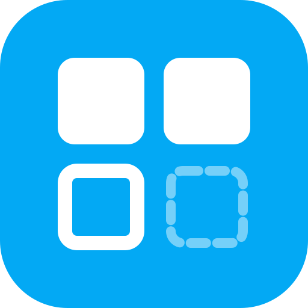
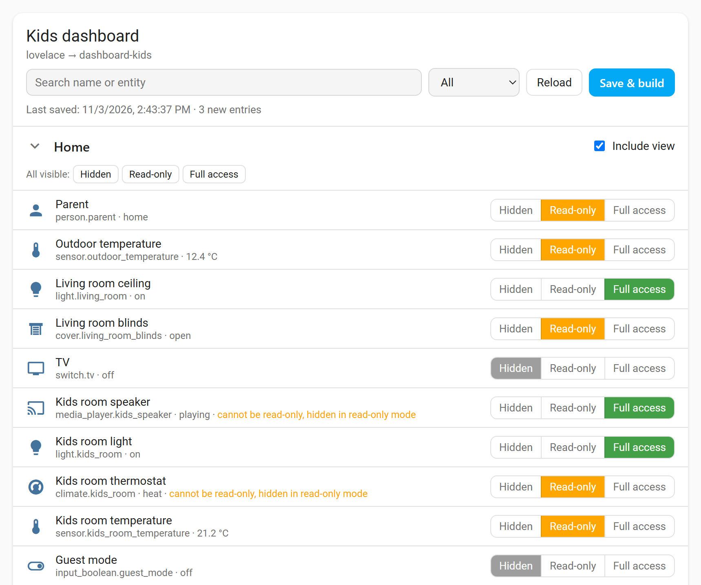
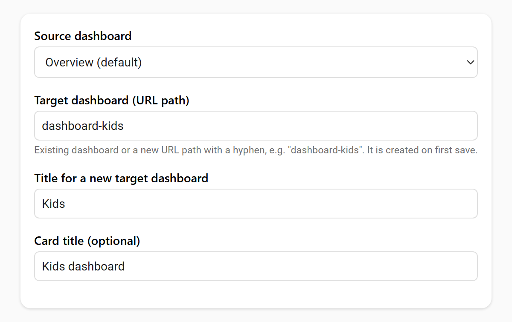
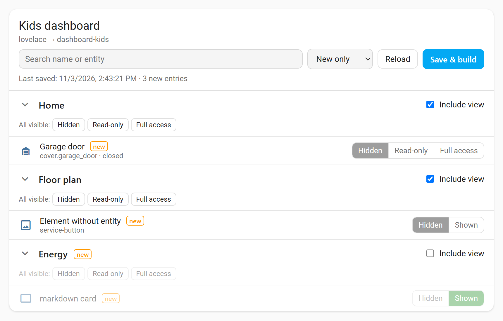

# Dashboard Filter Card

[](https://hacs.xyz/docs/faq/custom_repositories)
[](https://github.com/philipgo/dashboard-filter-card/actions/workflows/validate.yml)

Builds a restricted copy of a Home Assistant dashboard, e.g. for kids or guests.
Per entity you choose: **Hidden**, **Read-only** or **Full access**.



## Installation

**HACS:** HACS → ⋮ → Custom repositories → `https://github.com/philipgo/dashboard-filter-card`, type **Dashboard** → download.

**Manual:** Copy `dashboard-filter-card.js` to `/config/www/` and add `/local/dashboard-filter-card.js` as a JavaScript module resource.

## Setup

1. Create an **admin-only** dashboard for the card.
2. Add the card and choose source and target dashboard.
3. Set the modes and press **Save & build**. A missing target dashboard is created.



Or in YAML:

```yaml
type: custom:dashboard-filter-card
source: lovelace        # source dashboard (default: lovelace)
target: dashboard-kids  # target dashboard, must contain a hyphen
target_title: Kids      # optional, title if the target is created
title: Kids dashboard   # optional, card title
```

One card per target dashboard.

## Modes

| Mode        | Result                                                                      |
| ----------- | --------------------------------------------------------------------------- |
| Hidden      | Removed from the target.                                                    |
| Read-only   | Visible, tapping does nothing. Tile features and row toggles are removed.   |
| Full access | Copied unchanged.                                                           |

Cards with built-in controls (thermostat, media control, alarm panel, light, most custom cards)
cannot be read-only and are hidden in read-only mode. The card marks them.

## Updating

The target is a copy. After changing the source, open the card, filter **New only**, set the new
entries and press **Save & build**. The target is rebuilt completely – do not edit it by hand.



## Limitations

- **Not access control.** Users can still control any entity via search, more-info dialogs, Assist or the API.
- Target dashboards in YAML mode are not supported.

## Credits

Built with [Claude](https://claude.ai) (Anthropic) as AI coding assistant.

## License

[GPL-3.0-or-later](LICENSE)
